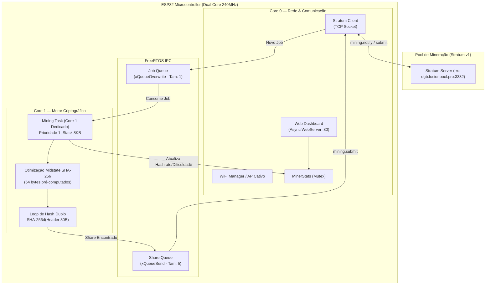
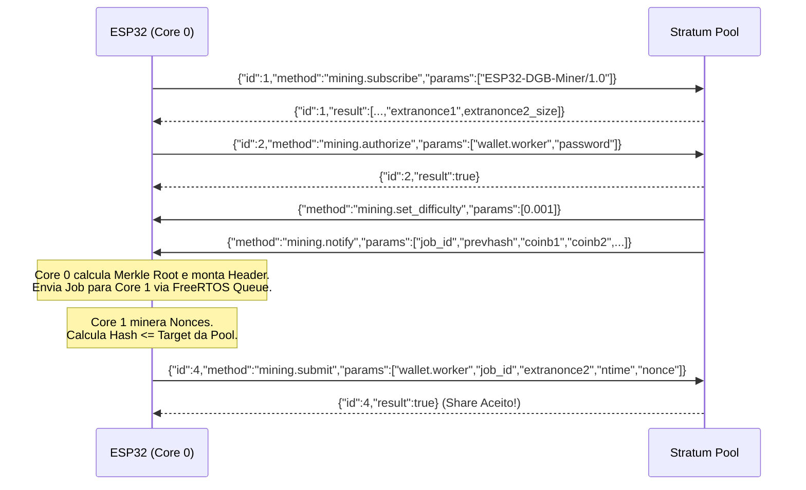

# 🏛️ Arquitetura Técnica — ESP32 DGB Miner

Este documento descreve detalhadamente o fluxo interno, arquitetura FreeRTOS, protocolo de comunicação Stratum v1 e otimizações matemáticas do **ESP32 DGB Miner**.

---

## 🧩 1. Visão Geral da Arquitetura

O firmware divide o processamento entre os dois núcleos independentes de 240 MHz do ESP32 através de **FreeRTOS Queues e Semaphores**:

---

## ⚡ 2. Otimização Criptográfica (Midstate Caching)

O algoritmo **SHA-256d** calcula dois hashes SHA-256 consecutivos sobre o cabeçalho de bloco Bitcoin/DigiByte de 80 bytes:

$$\text{Hash} = \text{SHA256}(\text{SHA256}(\text{Header}_{80}))$$

Como o cabeçalho tem 80 bytes:
1. O primeiro bloco de SHA-256 consome os primeiros **64 bytes** (Versão + PrevHash + parte da Merkle Root).
2. O campo **Nonce** (4 bytes) varia apenas nos últimos **16 bytes** (bytes 64 a 79).

### 🚀 Por que isso acelera o ESP32?
Em vez de reprocessar os 80 bytes a cada nonce testado:
* O firmware pré-calcula o estado interno do SHA-256 nos primeiros 64 bytes uma única vez por Job recebido (**Midstate de 32 bytes**).
* Para cada Nonce testado (de `0x00000000` a `0xFFFFFFFF`), o motor injeta o Midstate e calcula o hash apenas dos 16 bytes finais.
* **Ganho de Desempenho:** Quase **dobra a taxa de hash**, atingindo ~12 a 15 kH/s estáveis por placa sem risco de watchdog reset.

---

## 🔄 3. Fluxo de Comunicação Stratum v1 (JSON-RPC)

O cliente em `stratum_client.cpp` implementa o protocolo Stratum v1 padrão:

---

## 📦 4. Tratamento de Endianness (Byte-Swapping)

O protocolo Stratum transmite campos em formatos com ordenação de bytes mista:
* **PrevHash:** Vem em 8 grupos de 4 bytes em Big-Endian. Cada grupo de 4 bytes precisa ser invertido para montagem correta do bloco Little-Endian.
* **Versão, nBits e nTime:** Recebidos em hexadecimais Big-Endian e invertidos para Little-Endian.
* **Merkle Root:** Gerada diretamente no formato correto pelo cálculo das árvores de Merkle com o coinbase modificado.
